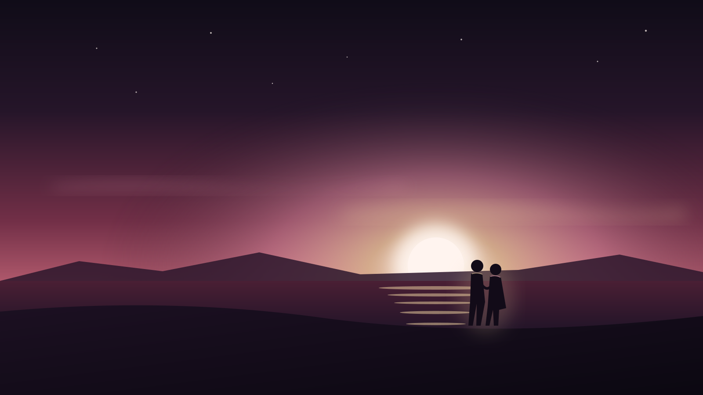
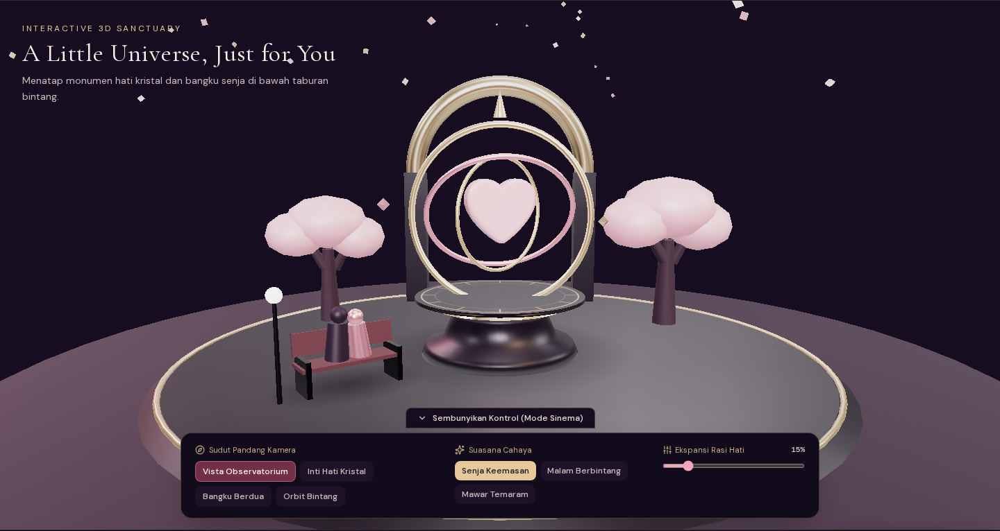
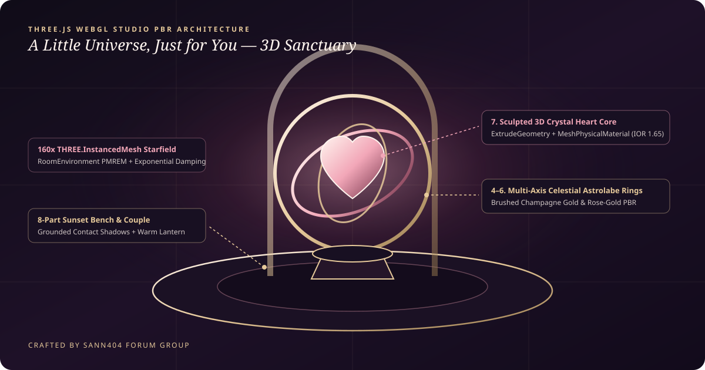

<div align="center">

# ✨ A Little Universe, Just for You

**Sebuah Pengalaman Digital Romantis Interaktif & Observatorium 3D WebGL**  
*Dirancang dengan estetika sinema editorial, tipografi klasik, musik instrumental interaktif, dan instalasi 3D Three.js.*

[](https://nextjs.org/docs/app)
[](https://react.dev)
[](https://www.typescriptlang.org/)
[](https://threejs.org/)
[](https://tailwindcss.com/)
[](#kredit--atribusi)

<br />



</div>

---

## 📖 Ikhtisar Proyek (Project Overview)

**A Little Universe, Just for You** bukan sekadar halaman kartu ucapan statis atau template landing page biasa. Proyek ini dirancang sebagai **perjalanan cinta digital interaktif** (*Interactive Romantic Digital Experience*) yang membawa pasangan melalui rangkaian emosi yang hangat, personal, dan sinematik:

1. **Opening Screen (*A Secret Just for You*)** — Amplop digital berwarna *romantic burgundy* dengan segel lilin berbentuk hati yang membuka secara 3D disertai pendaran cahaya hangat dan partikel hati.
2. **Hero Section (*My Favorite Person*)** — Visual *golden hour* dramatis dengan tipografi *Cormorant Garamond* bertahap dan navigasi halus.
3. **Editorial Love Letter (*A Letter From My Heart*)** — Halaman jurnal pribadi berlatar *warm ivory* dengan kontrol ukuran teks (*Normal*, *Besar*, *Sangat Besar*) dan fitur putar ulang animasi bacaan.
4. **Interactive 3D Sanctuary (*Three.js WebGL Observatory*)** — Instalasi 3D interaktif yang menampilkan monumen *Celestial Heart Astrolabe*, bangku senja bersama pasangan, pohon sakura mekar, dan 160 bintang *instanced* dengan kontrol kamera dan mode ekspansi rasi hati.
5. **Photo Gallery (*Little Moments, Big Feelings*)** — Tata letak *Bento/Masonry* asimetris bergaya majalah fotografi dengan *Lightbox* interaktif yang mendukung navigasi *keyboard* dan layar sentuh.
6. **Our Little Timeline (*Cerita Kita*)** — Garis perjalanan waktu dengan *progress line* animatif berbasis posisi gulir (*scroll-linked spring*).
7. **Interactive Love Notes (*Things I Adore About You*)** — Kartu catatan interaktif yang dapat dibalik satu per satu maupun sekaligus untuk menampilkan pesan apresiasi personal.
8. **Special Moment & Final Virtual Hug** — Momen klimaks di bawah langit berbintang yang diakhiri dengan interaksi pelukan virtual (*Sending you the warmest hug*).
9. **Our Little Soundtrack** — Pemutar musik latar mengambang (*floating music dock*) dengan *synthesizer* Web Audio API bernuansa *Nocturne Piano* romantis serta dukungan penuh untuk file audio MP3/WAV kustom.

---

## 🪐 Arsitektur & Visualisasi 3D Sanctuary (`Three.js WebGL`)

Bagian **Interactive 3D Sanctuary** dibangun menggunakan **Three.js** dengan pendekatan *Studio Physically Based Rendering (PBR)* dan model prosedural multi-komponen tanpa ketergantungan aset 3D eksternal yang rawan gagal dimuat (*Zero-404 Procedural Craft*).

<div align="center">

### Tampilan Render Langsung 3D Sanctuary


<br />

### Diagram Arsitektur Komponen 3D PBR


</div>

### Detail Teknis Mesin 3D (`components/three/RomanticUniverseScene.tsx`)

| Komponen 3D | Geometri & Material PBR | Fitur & Interaksi |
| :--- | :--- | :--- |
| **9-Part Celestial Heart Astrolabe** | `LatheGeometry` pedestal, `TorusGeometry` 3-axis gimbal rings (*Brushed Champagne Gold* & *Rose Gold*), `ExtrudeGeometry` 3D Heart Core dengan `MeshPhysicalMaterial` (`transmission: 0.88`, `ior: 1.65`, `clearcoat: 1.0`). | Berputar secara independen pada tiga sumbu dan merespons slider **Ekspansi Rasi Hati (0%–100%)** secara mulus (*exploded view*). |
| **Engraved Celestial Dial** | Tekstur kompas astronomi resolusi tinggi yang digenerasi secara prosedural melalui HTML5 2D `CanvasTexture` dengan `SRGBColorSpace` dan `maxAnisotropy`. | Memberikan detail ukiran presisi pada dasar monumen saat dilihat dari sudut kamera rendah (*grazing angles*). |
| **8-Part Sunset Bench & Couple** | `THREE.Group` yang menggabungkan rangka besi tempa (`metalness: 0.82`), bilah kayu hangat (`roughness: 0.78`), siluet pasangan duduk berdampingan, dan lentera observatorium bercahaya. | Dilengkapi *radial contact shadow* lembut di permukaan teras agar menyatu secara realistis dengan lantai. |
| **160x Instanced Starfield** | `THREE.InstancedMesh` dengan variasi skala dan warna per-instansi (`#FFF5EF`, `#F2A7B8`, `#E6C99A`, `#D8B4FE`) serta `computeBoundingSphere()`. | Menggambar ratusan objek bintang hanya dalam **1 draw call** untuk performa 60fps tanpa beban *Garbage Collection*. |
| **Studio PBR Lighting & Fog** | `RoomEnvironment` + `PMREMGenerator`, `ACESFilmicToneMapping`, *Warm Key DirectionalLight*, *Cool HemisphereLight*, dan `THREE.FogExp2`. | Mendukung 3 tema pencahayaan instan: **Senja Keemasan**, **Malam Berbintang**, dan **Mawar Temaram**. |
| **Collapsible Cinema Dock** | Panel kontrol bawah terpadu dengan tombol sembunyikan/tampilkan (**Mode Sinema** atau tombol pintas keyboard `H`). | Menggunakan permukaan solid `bg-[#120B1B]` tanpa `backdrop-filter` di atas kanvas WebGL agar *rendering* tetap ringan di semua perangkat. |

---

## 🎨 Arah Desain Visual & Palet Warna

Desain menggabungkan estetika film romantis, *editorial monograph*, dan kontras tipografi yang terukur:

| Nama Warna | Kode Hex | Peran Visual |
| :--- | :--- | :--- |
| **Midnight Black** | `#100C18` | Kanvas latar utama malam berbintang (60% Dominant Neutral Canvas) |
| **Deep Plum** | `#251529` | Permukaan struktural, kartu catatan, dan kedalaman bayangan (30% Surface) |
| **Romantic Burgundy** | `#722F47` | Amplop pembuka, aksen tombol utama, dan kartu yang terbuka |
| **Soft Rose** | `#F2A7B8` | Sorotan tipografi *italic*, hati kristal, dan partikel romantis |
| **Warm Ivory** | `#FFF5EF` | Tipografi utama dan lembaran jurnal surat cinta untuk kontras bacaan |
| **Champagne Gold** | `#E6C99A` | Garis tepi halus (*hairline borders*), segel lilin, dan cincin astrolabe (10% Accent) |

### Tipografi (`next/font/google`)
- **Judul & Editorial Display**: **Cormorant Garamond** (*Regular*, *Italic*, *SemiBold*) — memberikan kesan puitis, sinematik, dan klasik.
- **Teks Bacaan & Navigasi UI**: **DM Sans** — menjaga keterbacaan tinggi pada layar ponsel maupun desktop.

---

## 🛠️ Kustomisasi Mudah (Satu File Konfigurasi)

Seluruh data personal—mulai dari nama pasangan, tanggal spesial, isi surat cinta, daftar foto galeri, timeline hubungan, hingga URL musik—tersimpan di satu tempat terpusat:

📄 **`data/love-config.ts`** *(juga diekspor ulang di `src/data/love-config.ts`)*

```ts
export const loveConfig: LoveConfig = {
  senderName: 'Nama Kamu',
  recipientName: 'Nama Pacar',
  creditGroup: 'SANN404 FORUM GROUP',
  // Isi dengan format YYYY-MM-DD (misal: '2024-02-14') untuk menghitung durasi otomatis,
  // atau biarkan '' untuk menampilkan label placeholder yang jujur.
  anniversaryDate: '',
  siteTitle: 'A Little Universe, Just for You',
  musicUrl: '', // Opsional: isi URL file MP3/WAV pribadi, atau biarkan kosong untuk Nocturne Piano bawaan
  // ...
};
```

### Mengganti Foto Galeri dengan Foto Pribadi
1. Simpan foto pribadi Anda di dalam folder `public/images/` (misalnya `public/images/foto-kita-1.jpg`) atau gunakan tautan gambar dari Unsplash.
2. Ubah properti `src` pada array `gallery` atau `hero.heroImage` di `data/love-config.ts`.
3. Komponen `RomanticPhoto` dilengkapi pengaman otomatis (*Zero-Broken-Image Fallback*): apabila URL eksternal gagal dimuat karena koneksi, halaman secara otomatis menampilkan ilustrasi SVG romantis bawaan tanpa merusak tampilan.

---

## 📂 Struktur Direktori Proyek

```text
.
├── app/
│   ├── globals.css                 # Konfigurasi Tailwind CSS v4 & variabel font
│   ├── layout.tsx                  # Root layout, Google Fonts, OpenGraph & Favicon hati
│   └── page.tsx                    # Entry point halaman utama (mendukung ?autostart=1)
├── components/
│   ├── RomanticExperienceClient.tsx # Pengelola alur intro amplop & halaman utama
│   ├── effects/
│   │   ├── AmbientBackground.tsx   # Cahaya radial, taburan bintang, dan vignette
│   │   └── HeartParticles.tsx      # Partikel hati melayang (mendukung reduced-motion)
│   ├── intro/
│   │   └── OpeningScreen.tsx       # Layar pembuka amplop 3D burgundy & segel hati
│   ├── music/
│   │   └── MusicPlayer.tsx         # Pemutar musik Web Audio Nocturne + HTML5 Audio
│   ├── navigation/
│   │   └── TopBar.tsx              # Navigasi atas 3-zona yang bersih & responsif
│   ├── sections/
│   │   ├── HeroSection.tsx         # Bagian pembuka utama dengan siluet golden hour
│   │   ├── LoveLetter.tsx          # Surat cinta bergaya jurnal dengan pengatur ukuran teks
│   │   ├── PhotoGallery.tsx        # Galeri foto Bento asimetris + modal Lightbox
│   │   ├── LoveTimeline.tsx        # Timeline perjalanan hubungan dengan scroll progress
│   │   ├── LoveNotes.tsx           # Kartu interaktif "Things I adore about you"
│   │   ├── SpecialMoment.tsx       # Momen klimaks emosional di bawah bintang
│   │   └── FinalMessage.tsx        # Interaksi pelukan virtual & kredit penutup
│   ├── three/
│   │   └── RomanticUniverseScene.tsx # Instalasi 3D Three.js WebGL & kontrol sinema
│   └── ui/
│       └── RomanticPhoto.tsx       # Komponen gambar tahan gagal dengan fallback SVG
├── data/
│   └── love-config.ts              # Pusat konfigurasi konten, nama, foto, dan teks
├── lib/
│   ├── love-logic.ts               # Fungsi murni kalkulasi durasi, galeri, dan damping 3D
│   ├── love-logic.test.ts          # Unit test otomatis menggunakan node:test
│   └── utils.ts                    # Utilitas penggabung kelas CSS
└── public/
    └── images/                     # Ilustrasi editorial SVG & tangkapan layar pratinjau 3D
```

---

## 🚀 Cara Menjalankan Proyek (Getting Started)

### 1. Prasyarat
Pastikan **Node.js 20+** dan **npm** sudah terpasang di perangkat Anda.

### 2. Instalasi Dependensi
```bash
npm install
```

### 3. Menjalankan Server Pengembangan
```bash
npm run dev
```
Buka [http://localhost:3000](http://localhost:3000) di browser untuk menikmati pengalaman dari halaman pembuka amplop, atau buka [http://localhost:3000?autostart=1](http://localhost:3000?autostart=1) untuk langsung menuju halaman utama.

### 4. Menjalankan Unit Test & Build Produksi
```bash
# Menjalankan pengujian unit logika aplikasi
node --test lib/love-logic.test.ts

# Memverifikasi kompilasi TypeScript dan membuat build produksi
npm run build
npm start
```

---

## ♿ Performa, Responsivitas & Aksesibilitas

- **Mobile-First Experience**: Dirancang agar tampil proporsional ketika dibuka melalui tautan WhatsApp di ponsel (Safari iOS & Chrome Android) tanpa *horizontal overflow* (`scrollWidth === innerWidth`).
- **60fps Lossless 3D Loop**: Objek vektor matematika (`Vector3`, `Color`, `Object3D`) dialokasikan satu kali di luar *render loop* untuk mencegah jeda *Garbage Collection*.
- **Keyboard & Screen Reader Friendly**: Mendukung navigasi tombol `ArrowLeft`, `ArrowRight`, dan `Escape` pada Lightbox galeri, tombol `H` untuk menyembunyikan kontrol 3D, serta atribut `aria-label` dan `aria-expanded` yang lengkap.
- **Reduced Motion Compliance**: Menghormati pengaturan `prefers-reduced-motion` pada sistem operasi pengguna.

---

## 🏆 Kredit & Atribusi

Proyek pengalaman interaktif ini dirancang, dikembangkan, dan dipersembahkan oleh:

<div align="center">

### **SANN404 FORUM GROUP**
*Digital Craftsmanship · Interactive WebGL Experiences · Modern Frontend Engineering*

Dibuat dengan penuh perhatian terhadap detail untuk menyampaikan perasaan yang tulus kepada orang terkasih.

</div>
